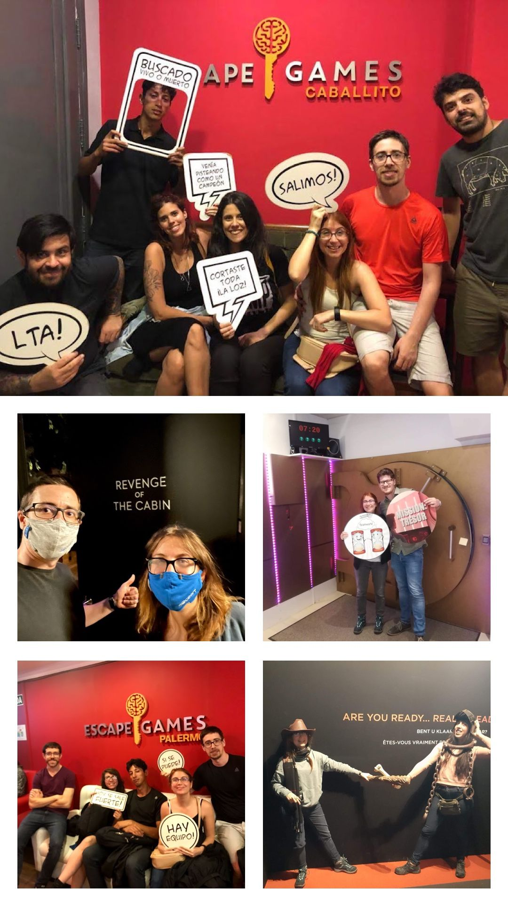
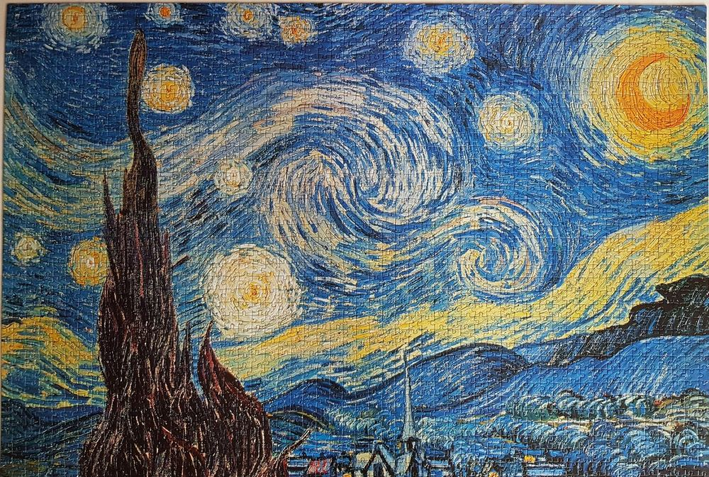
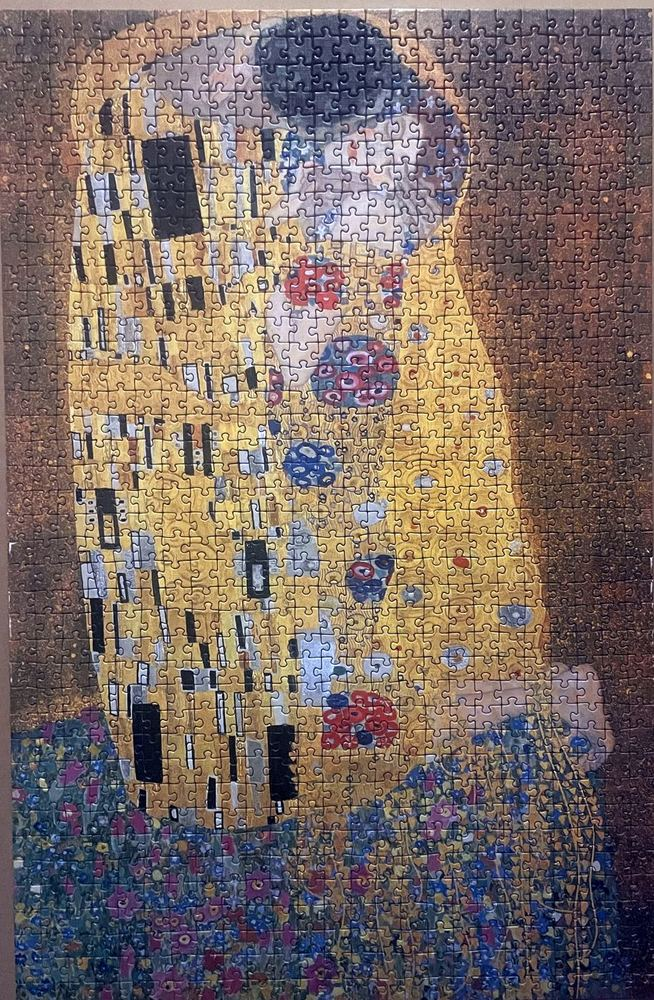
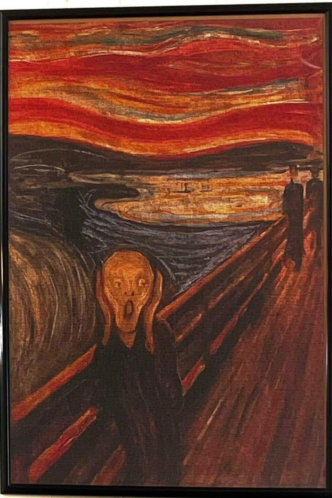
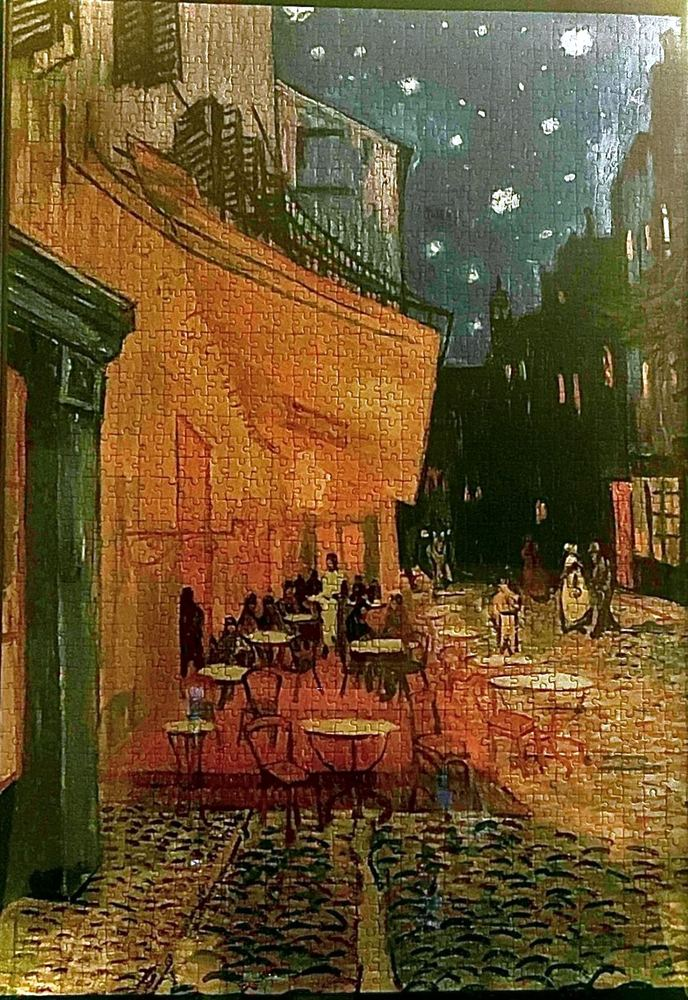
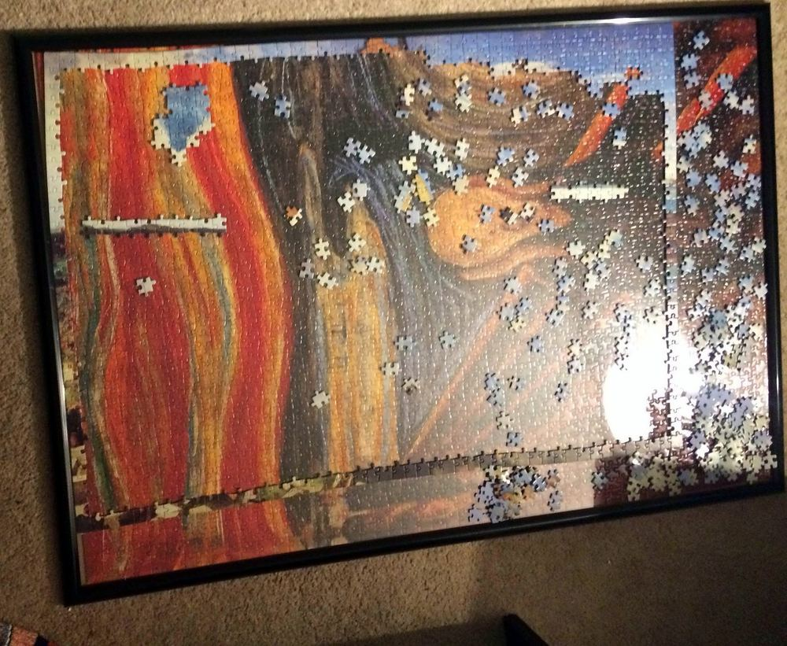
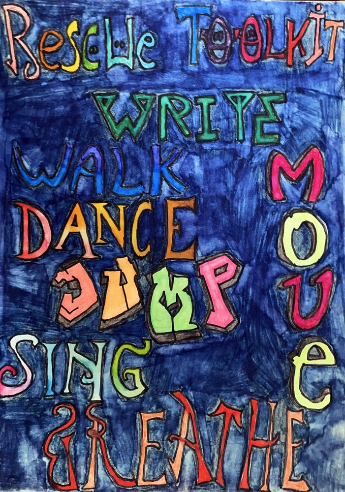
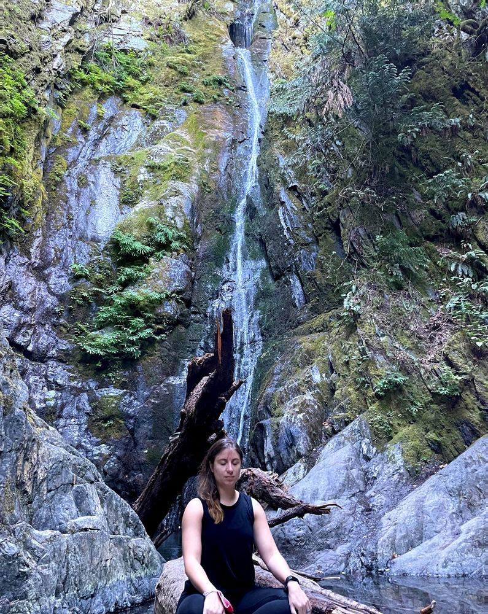

<h1>About Me</h1>

<section class="about-block">
  <h2>Escape rooms</h2>
  
I enjoy coordinating, leading and working as a team, particularly in escape rooms. I'm glad to have found awesome teammates.

  <figure class="photo photo-small"></figure>
</section>

<section class="about-block">
  <h2>Puzzles</h2>
  
I love challenges, especially those that resemble puzzles. Here are some pictures of my jigsaw puzzle collection.

  

    <figure><figcaption>Van Gogh, <i>The Starry Night</i></figcaption></figure>
    <figure><figcaption>Klimt, <i>The Kiss</i></figcaption></figure>
    <figure><figcaption>Munch, <i>The Scream</i></figcaption></figure>
    <figure><figcaption>Van Gogh, <i>Café Terrace at Night</i></figcaption></figure>
    <figure><figcaption>Work in progress</figcaption></figure>
  

</section>

<section class="about-block">
  <h2>Well-being</h2>
  
I value taking care of my physical and emotional well-being. I'm an active member at Reformation Pilates Paris, and I practice <a href="https://www.positiveintelligence.com/" target="_blank" rel="noopener">Positive Intelligence</a> and <a href="https://www.headspace.com/meditation-101/what-is-meditation" target="_blank" rel="noopener">meditation</a>.

  

    <figure><figcaption>My rescue toolkit</figcaption></figure>
    <figure></figure>
  

</section>
